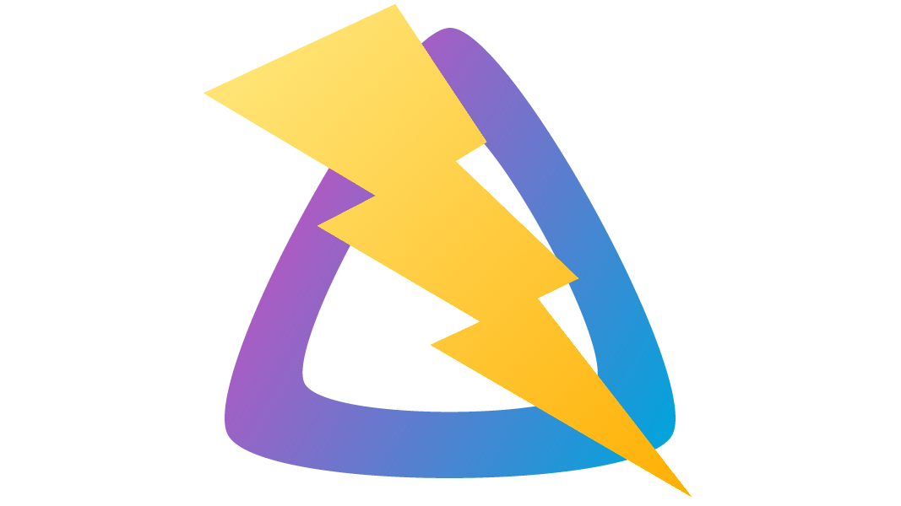
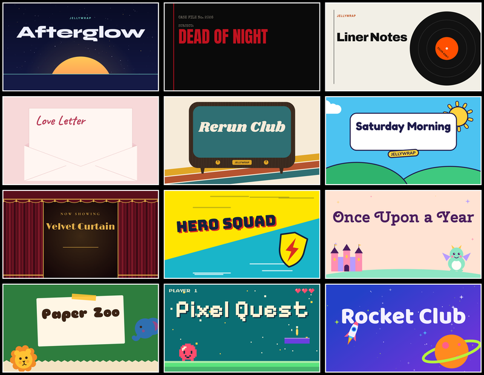
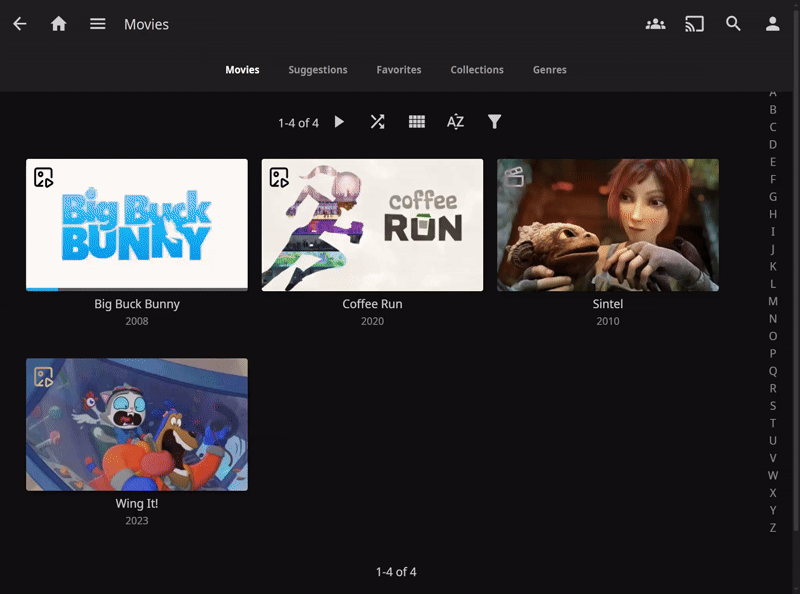
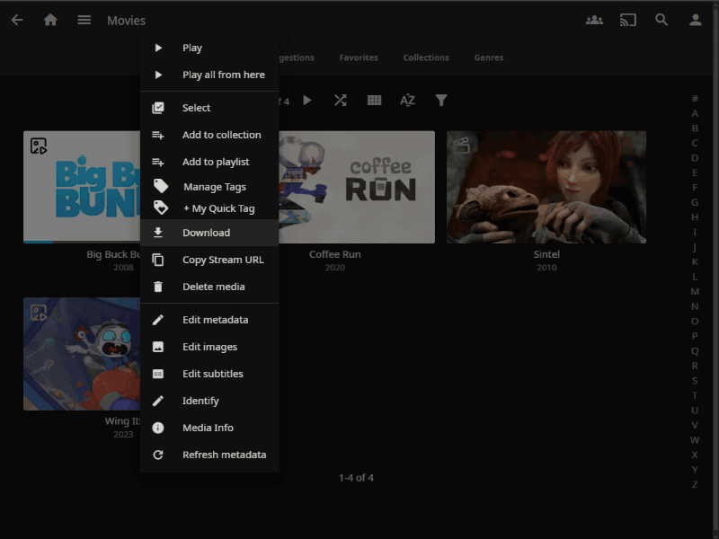
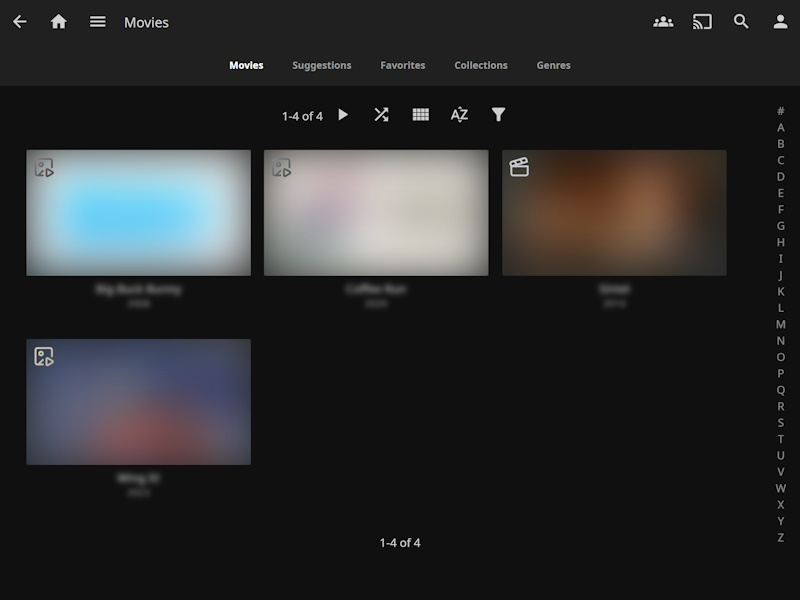

  

# Jellyfin Powertoys

A collection of plugins to enhance Jellyfin media server with additional features and tools.

## Installation

1. Go to the Jellyfin Administration Dashboard
2. Navigate to **Plugins** > **Catalog**
3. Add the catalog URL: `https://raw.githubusercontent.com/lennykean/jellyfin-powertoys/main/manifest.json`
4. Install the desired plugins
5. Restart the Jellyfin server

## Jellyfin versions and releases

| Jellyfin version | Source branch    | Plugin release line |
| ---------------- | ---------------- | ------------------- |
| 12               | `main`           | `1.4.x.x`           |
| 10.11.9          | `jellyfin-10.11` | `1.3.x.x`           |
| 10.9             | `jellyfin-10.9`  | `1.1.x.x`           |

Each branch releases independently. All releases update the shared catalog at `main/manifest.json`, so the catalog URL stays the same.

Create release tags on the corresponding source branch and keep their version numbers within that branch's release line. Newer Jellyfin lines must have higher plugin version numbers because Jellyfin selects the highest compatible version from the catalog.

# Jellywrap

A Spotify Wrapped style video of Jellyfin's usage over the year.

---

---

Jellywrap videos are automatically generated by default on December 1st of each year. They are generated for each user and the whole server. Settings can be customized and the videos can be regenerated manually. 12 templates are included, along with the ability to create custom templates.

- Videos are rendered entirely in Jellyfin using Skia and a custom template engine, with no additional dependencies
- Each video is set to the theme songs of that person's most watched shows
- Child templates are used for children's accounts
- Templates are chosen at random by default, but can be explicitly set per user in the settings panel
- Custom templates are supported, and a starter is included

---

### Included Templates:

---

# Thumbnail Previews

**Adds thumbnail previews using trickplay images or trailers.**

- **Slideshow Preview** - Cycles through trickplay images as an animated slideshow.
- **Trailer Preview** - Plays a video trailer directly on the thumbnail.
  - Uses local or remote trailers if available
- **Hover Play** - Triggers previews or automatically on mouse hover

---

---

# Remote Trailers

**Enables playback of remote trailers from any source.**

- Play trailers from any remote source (not just YouTube)
- Basic HTML video player

# Cast Curator

**Automatically organize your library by cast and crew members.**

- Creates collections based on actors, directors, writers, and other crew members
- Flexible filtering options allow customization and selection of which cast or crew to include

# Studio Curator

**Automatically organize your library by studio.**

- Creates collections based on production studios
- Flexible filtering options allow customization and selection of which studios to include

# Watch History Janitor

**Cleans up the "Continue Watching" history after a specified time period.**

- Automatic cleanup of "Continue Watching" section
- Customizable options control how long to keep history, and which users to target.

# JellyTag

**Simplified tag management. Add, remove, and manage tags right from the context menu.**

- **Quick Tags** - Pin your most-used tags to the context menu for one-click tagging
- **Add/Remove Tags** - Add new tags or remove existing ones right from the context menu
- **Bulk Editing** - Select multiple items and edit all their tags at once

---

---

# Privacy Mode

**Adds a privacy mode that hides content when activated.**

- Adds a privacy blur to the Jellyfin interface
- Optional reveal on hover
- Toggle via hotkeys

---

